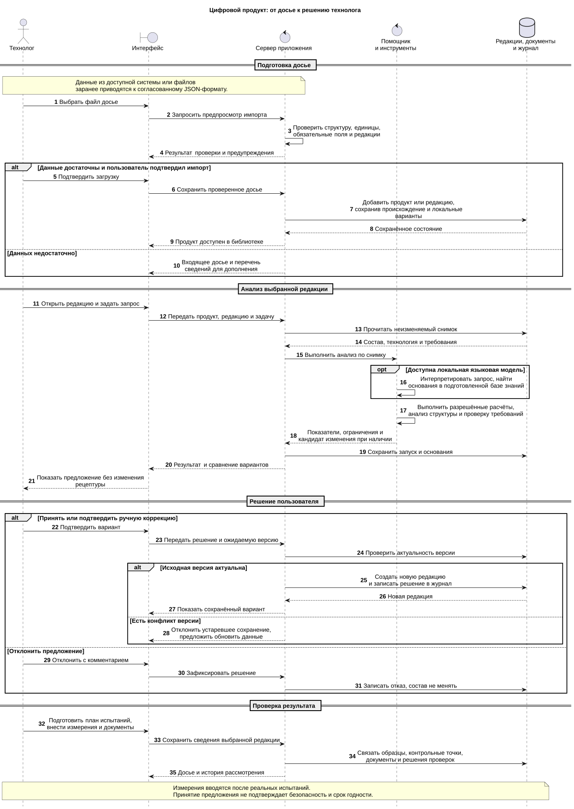

# Цифровой продукт

**Система поддержки разработки пищевых рецептур: от исходного состава и требований до сравнения вариантов, испытаний и решения специалиста.**

«Цифровой продукт» представляет пищевой продукт как связанное досье: рецептура, сырьё, технология, целевые показатели, расчёты, визуальная модель, документы и история решений. Такое представление позволяет рассматривать каждый вариант вместе с условиями его получения и основаниями выбора.

На основе данных о рецептуре система пересчитывает состав на порцию и партию, определяет доступные пищевые показатели и стоимость сырья, анализирует структуру, строит интерактивное 3D-представление, сопоставляет показатели с требованиями и помогает подготовить изменения. Планы испытаний и введённые измерения дополняют досье; предложения помощника применяются после решения человека.

## Какие данные использует

| Данные | Что учитывается | Для чего используются |
|---|---|---|
| Состав | Сырьё, масса каждого компонента, доли и принадлежность к фазе | Пересчёт пропорций, анализ состава и структуры |
| Спецификации сырья | Пищевая ценность на 100 г, аллергены, категория, доступные свойства | Расчёт КБЖУ, перечня аллергенов и объяснимых индексов |
| Цены | Цена за килограмм и сведения о её основании | Расчёт стоимости сырьевой загрузки и стоимости сырья на единицу выхода |
| Технология | Последовательность операций, фазы, время, температура и доступные параметры | Анализ способа получения продукта и построение визуального представления |
| Выход и упаковка | Масса готового продукта, отделяемые потоки, масса порции и число упаковок | Баланс масс и масштабирование задания |
| Требования к продукту | Целевые значения, диапазоны, единицы и основания критериев | Проверка соответствия редакции поставленной задаче |
| Испытания | Образцы, условия, методики, контрольные точки и измерения | Планирование проверки и накопление фактических результатов |
| Документы и происхождение | Связанные файлы, исходная запись, версия и история | Прослеживаемость данных и решений |

Неизвестное значение сохраняется как отсутствие данных. Если не хватает цены или пищевого показателя, система показывает неполноту, а не подставляет ноль. Для процессов с отделением фаз пищевые показатели готового продукта требуют данных о составе этих потоков.

## Какие модули есть в системе

**Библиотека и досье продукта.** Содержит продукты и их редакции, поддерживает поиск, фильтрацию и настройку таблицы. Редакция связывает состав с технологией, требованиями, планами и документами. История позволяет вернуться к варианту, на котором было принято решение.

**Расчётный модуль.** Пересчитывает рецептуру по массе порции и размеру партии, проверяет баланс входа и выхода, рассчитывает доступные КБЖУ, стоимость сырья и аллергены. Числовые расчёты выполняются программными правилами отдельно от языковой модели.

**Анализ свойств и 3D-визуализация.** Использует состав, распределение компонентов по фазам и порядок операций для представления структуры. Слоистая сборка и смешивание дают разные представления; переименование продукта не меняет физический вход. Модель можно вращать и приближать. Сенсорные индексы служат объяснимыми оценками правил; для физических характеристик без основания выводится отсутствие данных.

**Помощник технолога.** Принимает запрос, выбирает разрешённые инструменты, запускает расчёты, проверяет требования и готовит вариант изменения состава или технологии. Локальная языковая модель помогает интерпретировать запрос и находить сведения в подготовленной базе знаний. Пользователь видит предложение, сравнение вариантов и ограничения, затем принимает, отклоняет или корректирует его. Принятие создаёт новую редакцию.

**Испытания и измерения.** Позволяет подготовить планы для технологической обработки, перевозки, хранения и периода после вскрытия. В плане задаются образцы, условия и контрольные точки. Полученные значения вносятся вместе с методикой, временем и документом; план сам по себе не является результатом испытания.

**Документы и маршрут решения.** Связывает файлы с продуктом и редакцией, показывает комплектность и поддерживает проверки рецептуры и качества с итоговым решением. Возврат сопровождается причиной, действия сохраняются в истории. В прототипе используется локальный демонстрационный маршрут, без производственной аутентификации сотрудников.

**Обмен данными и контроль качества системы.** Обеспечивает предпросмотр импорта, проверку досье, обработку неполных данных и защиту от повторного создания одинаковых редакций. Отдельные проверки контролируют расчёты, поведение помощника и применение изменений. История проверок помогает обнаруживать регрессии.

## Для чего нужна система

При разработке рецептуры важно сопоставлять состав, технологию, требования и результаты испытаний для одного и того же варианта. Разрозненные таблицы и документы усложняют это сопоставление: одинаковое название может скрывать разные редакции, а расчёт без сведений о выходе может относиться к сырьевой загрузке вместо готового продукта.

Система помогает решать следующие задачи:

- Собирать сведения о варианте продукта в связанное досье и сохранять происхождение данных.
- Пересчитывать состав на нужный объём с учётом выхода и доступных исходных показателей.
- Сравнивать варианты по требованиям и показывать, какие выводы пока нельзя сделать.
- Подготавливать изменение рецептуры с понятным основанием и контролем со стороны технолога.
- Связывать планы, измерения и документы с конкретной редакцией.
- Сохранять основания согласования, возврата и выбора варианта.

Ожидаемый эффект оценивается по времени подготовки варианта, числу возвратов из-за неполных данных, времени поиска основания решения и доле досье с полным комплектом проверок. Значения этих показателей определяются при использовании системы; сокращение затрат или сроков без измерений не заявляется.

## Кому помогает

**Технологу и разработчику рецептур.** Даёт рабочее пространство для состава и технологии, пересчёта партии, сравнения вариантов и подготовки испытаний. Помощник может предложить изменение, но технолог определяет его применимость и подтверждает сохранение.

**Специалисту качества.** Позволяет видеть редакцию, к которой относятся образцы и документы, задавать условия и контрольные точки, фиксировать измерения и возвращать пакет с причиной. Отдельное хранение целей и измерений исключает их смысловую подмену.

**Руководителю разработки и владельцу процесса.** Даёт представление о состоянии работы, рассматриваемом варианте, недостающих данных и основаниях решения. История помогает разбирать возвраты и передачу результата между участниками.

**Бизнес- и системному аналитику.** Показывает связь бизнес-задачи с пользовательскими сценариями, данными, правилами расчётов и согласования. Прототип можно использовать для обсуждения границ автоматизации, требований к интеграциям, ответственности участников и критериев приёмки.

Роли описывают потребности участников. Полноценное управление правами, назначениями и корпоративными учётными записями относится к следующему этапу внедрения.

## Как проходит работа

1. **Подготовка исходных данных.** Пользователь получает сведения из доступной системы или файлов, проверяет состав, единицы, спецификации, операции и требования. При файловом импорте сначала рассматривает предпросмотр и предупреждения, затем подтверждает загрузку. Неполные досье требуют дополнения.
2. **Выбор продукта и редакции.** В библиотеке открывает нужное досье и проверяет, какой вариант состава и технологии рассматривается. Исходная редакция остаётся доступной при дальнейших изменениях.
3. **Постановка задачи.** Задаёт критерии продукта, например допустимый диапазон пищевого показателя, целевую структуру или ограничение стоимости сырья. Единицы и основания критериев сохраняются вместе с требованиями.
4. **Расчёт и анализ.** Пересчитывает состав на порцию или партию, проверяет выход и полноту показателей. Рассматривает 3D-представление и пояснения, связывающие структуру с компонентами и операциями.
5. **Подготовка варианта.** Обращается к помощнику, например с запросом уменьшить количество сахара на 15%. Система готовит кандидата, показывает отличия и последствия. При необходимости технолог корректирует состав вручную.
6. **Решение об изменении.** Пользователь принимает, отклоняет или исправляет предложение. Только принятие либо подтверждённая ручная правка сохраняет новую редакцию. Измерения и согласования исходного варианта не становятся автоматически подтверждением нового.
7. **Проверка варианта.** Формирует план испытаний, задаёт образцы и контрольные точки. После выполнения испытаний вносит фактические значения и прикладывает документы. Недостающие сведения остаются видимыми.
8. **Рассмотрение результата.** Выполняет предусмотренные проверки и фиксирует итоговое решение либо возврат с причиной. Досье сохраняет связь рецептуры, документов и истории действий.

Например, для творожного десерта с ягодным слоем можно сравнить исходный состав с вариантом уменьшения сахара. Изменение массы компонента влияет на расчёты; смешивание вместо послойной сборки меняет представление структуры. Подтверждение выхода и новые испытания рассматриваются отдельно от принятия предложения помощника.

## Демонстрация

Запись работы в приложении: открытие рецептуры, вращение модели, пересчёт партии, запрос помощнику, принятие предложения и новая редакция. Полный кадр 1920×1080, без обрезки и без озвучки. Переходы и ввод параметров ускорены выборочно, сохранены паузы на просмотр результатов. Длительность - 47 секунд.

https://github.com/user-attachments/assets/07739b5f-a9c4-4bd3-a5c1-2fda741ed801

[**Пример полного процесса работы**](demonstration/full-process/Пример%20полного%20процесса%20работы.md)

Полный процесс на примере ELMA365 готовится отдельно: для него создана [папка демонстрации](demonstration/elma365/). Выше показана работа самого приложения на демонстрационных данных.

[Скачать запись прототипа в MP4](https://raw.githubusercontent.com/eraretyui/digital-product/main/demonstration/prototype/prototype-demo.mp4) · [Последовательность действий в видео](demonstration/prototype/)

## Откуда могут поступать данные

Источником могут быть **ELMA365, 1С, другая доступная информационная система, таблицы Excel или документы Word (DOC/DOCX)**. При адаптации согласуются состав полей, единицы, обязательные параметры и правила связи редакций. Эти источники представляют варианты организации обмена.

В текущей реализации структурированная загрузка рецептур выполняется через JSON: поддерживаются файловое досье ELMA365 и нормализованный формат приложения. XLSX и DOCX можно прикладывать как документы. Автоматическое преобразование произвольных Excel и Word в рецептуру, старый формат DOC и прямое подключение к 1С требуют отдельного адаптера. Загрузка вложения не означает извлечение из него структурированных данных.

## Как устроена система

Диаграмма последовательности UML показывает обмен между технологом, интерфейсом, сервером, помощником и хранилищем: от проверки досье до анализа, решения об изменении и испытаний.



[Открыть диаграмму в полном размере](docs/diagrams/system-sequence.svg) · [Исходник PlantUML](docs/diagrams/system-sequence.puml)

Интерфейс работает в браузере, локальный сервер сохраняет данные и документы на компьютере пользователя. Расчёты и визуализация выполняются специализированными модулями. Помощник использует локальную модель при её наличии; ограниченный инструментальный режим доступен без модели. Для корпоративного развёртывания отдельно проектируются хранение, доступ и интеграции.

## Как адаптировать под организацию

Сначала определяются категория продуктов, задачи пользователей и границы процесса. Затем сопоставляются справочники сырья, единицы измерения, технологические операции, требования, методики испытаний и роли. Для обмена с исходной системой согласуются формат досье, идентификаторы, версии и обработка неполных данных.

Следующий шаг - проверка расчётных правил и представления структуры для выбранной категории на контрольных примерах и измерениях. После этого настраиваются маршрут решений и база знаний. Внедрение завершается пилотным сценарием с критериями приёмки и замером показателей процесса.

Изменение справочников и требований может выполняться без изменения общей идеи досье. Новые физические модели, интеграции, аутентификация и многопользовательское хранение требуют разработки и проверки.

## Границы применения

Цели, расчёты и фактические измерения хранятся раздельно. Сенсорные индексы основаны на правилах и не прошли лабораторную калибровку. 3D-модель объясняет состав и технологию, но не подтверждает физическую точность, вкус, безопасность или срок годности. Стоимость сырья не включает автоматически все производственные затраты.

В стартовом наборе представлены три демонстрационные рецептуры, без лабораторных результатов и данных реальных поставок. Публичная база знаний содержит правила работы прототипа. Личные выгрузки и документы рабочей среды в репозиторий не включены.

## Запуск

Нужен Node.js 22 или новее. В папке проекта выполните:

```bash
npm start
```

Откройте **http://127.0.0.1:4173**. При первом запуске создаются локальные данные. Остановка сервера: `Ctrl+C`.

[Подробный запуск и необязательные компоненты](docs/setup.md) · [Правила процесса и данных](docs/business.md) · [Устройство и обмен](docs/system.md) · [Сценарий демонстрации](docs/demo.md)
